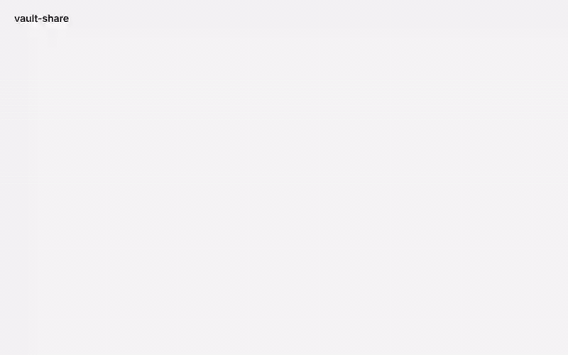
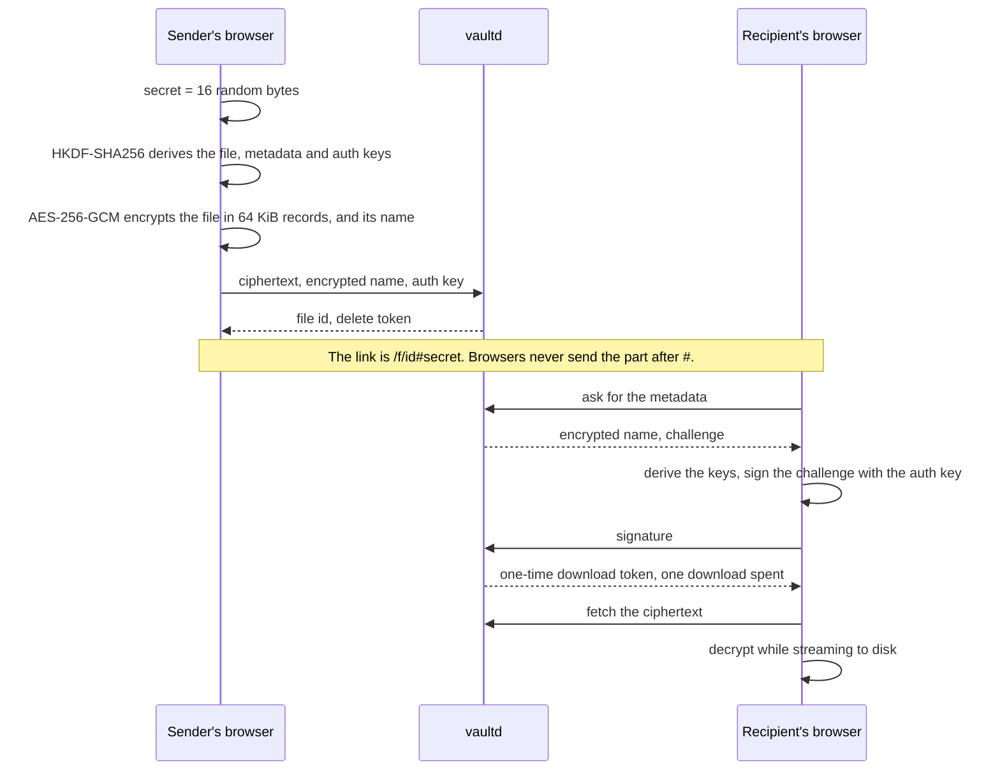

# vault-share

End-to-end encrypted file sharing. The browser encrypts a file before upload, and the key travels only in the link, after the `#`, which browsers never send. The server stores ciphertext and cannot read file contents or names. A link can expire, allow a set number of downloads, or burn after reading. An optional account keeps a list of the files you shared, still without the server reading them.



Go 1.27 with chi and SQLite, React 19 with TypeScript and Vite, Caddy for TLS. Ciphertext lives on local disk or in an S3-compatible bucket.

## How it works



- **Passwords.** With a password, the link carries the secret wrapped under a key that Argon2id derives from the password (64 MiB, 2 passes). The server never learns whether a password exists.
- **Integrity.** Each record carries its index and the last one is marked, so a changed, reordered or cut file fails to decrypt.
- **What the server keeps.** It stores ciphertext, the encrypted name, hashes of the tokens, and the auth key. The auth key proves that a request comes from someone holding the link, but it decrypts nothing.

The [specification](docs/SPEC.md) describes the scheme in full.

## Accounts

Sharing needs no account. With one, every file you share appears under My files, with its name, its link and a delete button.

- **The password stays in the browser.** Argon2id turns it into a master key, from which the browser derives the secret it signs in with and the key that seals a random account key. The server hashes that secret again with Argon2id and stores the sealed account key; neither opens anything.
- **My files.** For each file the browser seals the share secret, the link key and the delete token under the account key, bound to the file id. The server lists these entries; only your browser opens them, and through them the names.
- **Sessions.** An HttpOnly `__Host-` cookie with SameSite=Strict, ending after an hour idle or a day in all. Between page loads the browser keeps the account key sealed under a key the server releases only to the live session.
- **Two-factor sign-in.** Optional TOTP with any authenticator app, and ten one-time recovery codes.

There is no password reset: a forgotten password loses the account and its list, while the links you shared keep working. `VAULT_SIGNUP=closed` turns sign-ups off.

## Security

- **Browser hardening.** A strict Content Security Policy forbids inline script and eval, alongside HSTS, `no-referrer`, COOP, COEP and CORP.
- **Server answers.** Missing files, expired files, used-up files and wrong tokens all get the same 404. Requests from other sites are refused, and the API answers only for its own host.
- **Rate limits.** Each client, meaning one IPv4 address or one IPv6 /64, gets its own limits. Five wrong signatures lock that client out of a file for 15 minutes. A storage quota and a daily budget per client bound the storage, and a file takes one upload at a time.
- **Sign-in.** Failed sign-ins are counted per client, per account and per known browser, so guessing from many addresses is bounded while the owner's own browsers keep working. A second-step code works once, and changes to how an account signs in ask for the password again.
- **Supply chain.** Dependencies, CI actions and images are pinned by version or digest. The exception is the browser that Playwright installs in CI: its build follows the pinned Playwright release, and its system packages come from the runner. CI runs gosec, govulncheck, npm audit, Semgrep and a ZAP baseline scan, plus end-to-end tests on disk and on S3 and the security checks in [`scripts/`](scripts).
- **Self-assessment.** The project was tested against the OWASP Top 10:2025: see the [test report](docs/security/TEST_REPORT.md), the [threat model](docs/security/THREAT_MODEL.md) and the [findings](docs/security/FINDINGS.md) fixed along the way.

To report a vulnerability, see [SECURITY.md](SECURITY.md).

## Known limitations

- **A compromised server** can send JavaScript that steals keys. Every web-based encryption tool shares this weakness.
- **A leaked link is a leaked file.** A password slows offline guessing down, but cannot stop it.
- **What the server sees.** It knows each file's size and when it was uploaded and downloaded.
- **Limits are per address.** They count one IPv4 address or one IPv6 /64 as one client. An attacker with many addresses can fill the quota or load the CPU, which needs protection in front of the server.
- **Accounts link files.** The server knows which files an account keeps and when they were shared, though not what they are. A captured account password opens all of them.
- **Single instance.** It runs as one process; its rate limits and lockouts live in memory.

## Quick start

```bash
docker compose up --build
```

Open <https://localhost>. Caddy signs the certificate with its own local CA, so the browser warns once; accept it for local use. [.env.example](.env.example) lists every setting.

## S3 storage

With `VAULT_STORAGE=s3`, ciphertext goes to an S3-compatible bucket instead of the data volume. To try it against a throwaway local gateway:

```bash
docker compose -f compose.yaml -f compose.s3.yaml up --build
```

For a real bucket, set the `VAULT_S3_*` settings in `.env`. The bucket must:

- belong to vaultd alone, because cleanup deletes every object named like a file id that has no record;
- have versioning off, or deleted files would stay as old versions;
- support conditional writes (`If-None-Match`), which keep stored content from being replaced.

vaultd checks the last two at startup and refuses to start otherwise. Its credentials need `s3:ListBucket`, `s3:GetBucketVersioning`, `s3:GetObject`, `s3:PutObject` and `s3:DeleteObject` on the bucket. Files on S3 are capped at 5 GiB, the most S3 takes in one request. Switching storage moves no files, so switch once the existing shares have expired, at most seven days after the last upload.

## Upgrading

A deployment built before 10 November 2026 (commit `96159bb` or earlier) meets these changes:

- **A missing database stops the start.** vaultd used to create `vault.db` whenever it was missing, and cleanup then deleted the stored files it had no record of. It now refuses to start when the database is missing and the storage is not empty. Restore `vault.db`, or empty the `blobs` directory or the bucket to start over. An upgrade in place keeps its database and is not affected.
- **`/healthz` can answer 503.** It now checks the database, the storage and the free space on the data volume, 128 MiB at least, where it used to answer 200 always. A monitor or load balancer that probes it will report an instance that is short of disk or has lost its storage.
- **A missing `account.key` stops the start.** vaultd used to create a new one whenever it was missing. It now refuses to start when the key is missing and the database holds accounts, because a new key breaks their authenticator codes and signs every browser out. Restore the key, or see the [operations manual](docs/OPERATIONS.md#startup-refusals) to replace it on purpose.
- **Leftover content goes later.** Stored content without a record is deleted from an hour after the start, at most 100 objects an hour, instead of at startup.

## Development

```bash
cd server && go test -race ./...
```

```bash
cd web && npm ci && npm test && npm run dev
```

Running vaultd outside Docker needs `VAULT_BASE_URL` set to the address you open, because the API answers only for that host. With the stack running, `npm run e2e` in `web/` runs the end-to-end tests. The [test report](docs/security/TEST_REPORT.md#6-reproducing) shows how to run the security checks.

## Docs

- [Specification](docs/SPEC.md)
- [Design decisions](docs/DECISIONS.md)
- [Operations: backup, restore, startup refusals](docs/OPERATIONS.md)
- [Threat model](docs/security/THREAT_MODEL.md)
- [Security test report](docs/security/TEST_REPORT.md)

## License

MIT
