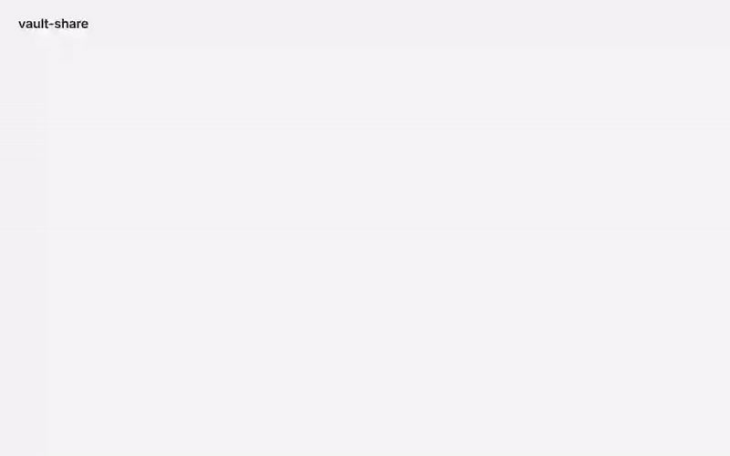
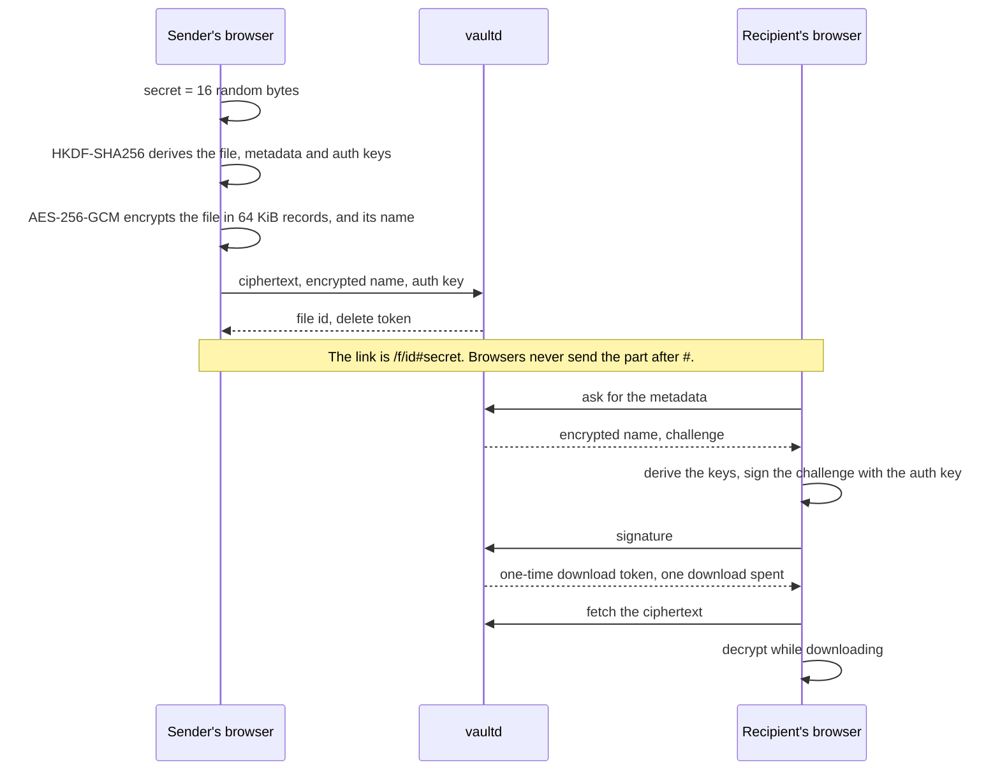

# vault-share

[](https://github.com/sHyanorn/vault-share/actions/workflows/ci.yml?query=branch%3Amain)

End-to-end encrypted file sharing. The browser encrypts a file before upload, and the key travels only in the link, after the `#`, which browsers never send. The server stores ciphertext and cannot read file contents or names. A link can expire, allow a set number of downloads, or burn after reading. An optional account keeps a list of the files you shared, still without the server reading them. The project was tested against the OWASP Top 10:2025 in a self-assessment. A compromised server can still send JavaScript that steals keys.



## Results

- **Self-assessment.** Tested against the OWASP Top 10:2025: see the [test report](docs/security/TEST_REPORT.md), the [threat model](docs/security/THREAT_MODEL.md) and the [findings](docs/security/FINDINGS.md) recorded along the way.
- **Test vectors.** The browser's cryptography is checked against the Wycheproof vectors for AES-GCM, HKDF and HMAC in Chromium, Firefox and WebKit. The share format is checked against a second implementation in Python written from the specification, with fixed vectors for damaged and cut files.
- **CI.** gosec, govulncheck, npm audit, Semgrep and a ZAP baseline scan, end-to-end tests on disk and on S3, and the security checks in [`scripts/`](scripts).
- **Released client.** The client builds to the same bytes on every platform CI tests, and each release carries a signed manifest of the client's files ([verifying the client](docs/VERIFYING.md)).

## How it works



- **Passwords.** With a password, the link carries the secret wrapped under a key that Argon2id derives from the password (64 MiB, 2 passes). The server never sees the password.
- **Integrity.** Each record carries its index and the last one is marked, so a changed, reordered or cut file fails to decrypt.
- **What the server keeps.** Ciphertext, the encrypted name, hashes of the tokens, and the auth key, which proves that a request comes from someone holding the link and decrypts nothing.
- **Accounts.** Argon2id turns the account password into a master key in the browser. The browser seals each file's share secret, link key and delete token under a random account key, and only the browser opens them. Sessions use an HttpOnly `__Host-` cookie with SameSite=Strict. Two-factor sign-in with TOTP is optional.
- **Hardening.** A strict Content Security Policy, HSTS, `no-referrer`, COOP, COEP and CORP. Missing, expired and used-up files and wrong tokens all get the same 404. Each client has its own rate limits, storage quota and daily budget, and failed sign-ins are counted per client, per account and per known browser. Dependencies, CI actions and images are pinned by version or digest, except the browser that Playwright installs in CI.

Go 1.27.4 with chi and SQLite, React 19 with TypeScript and Vite, Caddy for TLS. Ciphertext lives on local disk or in an S3-compatible bucket. The [specification](docs/SPEC.md) describes the scheme in full.

## Run it

```bash
docker compose up --build
```

Open <https://localhost>. Caddy signs the certificate with its own local CA, so the browser warns once; accept it for local use. [.env.example](.env.example) lists every setting, and `VAULT_SIGNUP=closed` turns sign-ups off. To try S3 storage against a throwaway local gateway:

```bash
docker compose -f compose.yaml -f compose.s3.yaml up --build
```

A real bucket has three requirements, and vaultd checks two of them at startup; the [operations manual](docs/OPERATIONS.md#s3-storage) lists them, with backups, restores and the changes for deployments built before 10 November 2026.

Development:

```bash
cd server && go test -race ./...
cd web && npm ci && npm test && npm run dev
```

Running vaultd outside Docker needs `VAULT_BASE_URL` set to the address you open. With the stack running, `npx playwright install chromium` (once) and `npm run e2e` in `web/` run the end-to-end tests against `https://localhost`; `E2E_BASE_URL` tests another address. The [test report](docs/security/TEST_REPORT.md#6-reproducing) shows how to run the security checks.

## Limits

- **A compromised server** can send JavaScript that steals keys. Most web-based encryption tools share this weakness. Checking the client against the release covers only what the server sends the person checking, after the fact: a server can send the released client to them and a changed one to others, on any visit.
- **A leaked link is a leaked file.** A password slows offline guessing down, but cannot stop it. The [threat model](docs/security/THREAT_MODEL.md) lists how the server can still tell that a password exists.
- **What the server sees.** It knows each file's size and when it was uploaded and downloaded.
- **Accounts link files.** The server knows which files an account keeps and when they were shared, though not what they are. A captured account password opens all of them. There is no password reset: a forgotten password loses the account and its list, while the links you shared keep working.
- **Limits are per address.** They count one IPv4 address or one IPv6 /64 as one client. An attacker with many addresses can fill the quota or load the CPU, which needs protection in front of the server.
- **Single instance.** It runs as one process; its rate limits and lockouts live in memory.
- **Large files outside Chromium.** Chromium-based browsers write the decrypted file straight to disk. Other browsers hold it in browser storage until the download is complete.
- **Monitoring and backups are the operator's.** `/healthz` checks the database, the storage and the free disk space, but not the integrity of the database, and there are no metrics or alerts. Nothing is backed up automatically.
- **CI's browser is not pinned.** Its build follows the pinned Playwright release, and its system packages come from the runner.

To report a vulnerability, see [SECURITY.md](SECURITY.md).

## Docs and licence

[Specification](docs/SPEC.md) · [Design decisions](docs/DECISIONS.md) · [Operations](docs/OPERATIONS.md) · [Threat model](docs/security/THREAT_MODEL.md) · [Security test report](docs/security/TEST_REPORT.md) · [Verifying the client](docs/VERIFYING.md)

MIT licence.
