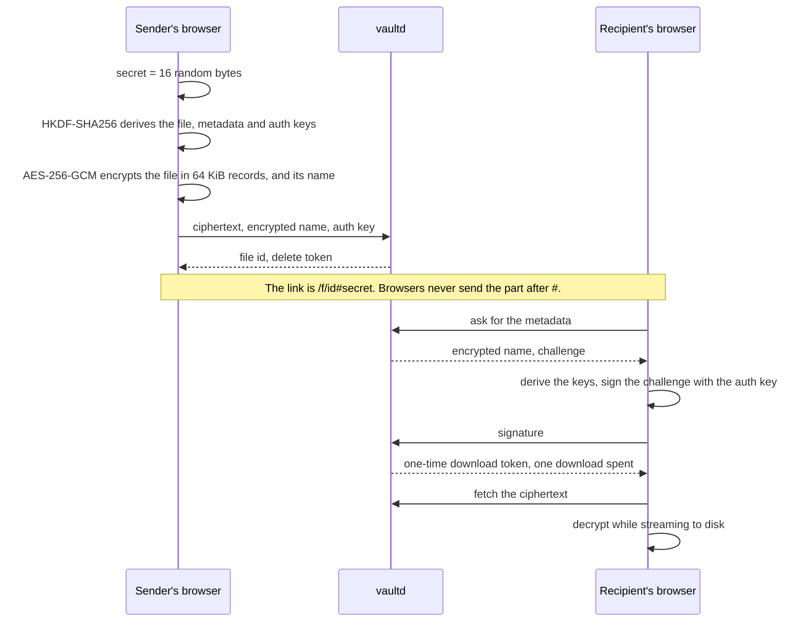

# vault-share

End-to-end encrypted file sharing. The browser encrypts a file before upload, and the key travels only in the link, after the `#`, which browsers never send. The server stores ciphertext and cannot read file contents or names. A link can expire, allow a set number of downloads, or burn after reading.


Go 1.27 with chi and SQLite, React 19 with TypeScript and Vite, Caddy for TLS. Ciphertext lives on local disk or in an S3-compatible bucket.

## How it works



- **Passwords.** With a password, the link carries the secret wrapped under a key that Argon2id derives from the password (64 MiB, 2 passes). The server never learns whether a password exists.
- **Integrity.** Each record carries its index and the last one is marked, so a changed, reordered or cut file fails to decrypt.
- **What the server keeps.** It stores ciphertext, the encrypted name, hashes of the tokens, and the auth key. The auth key proves that a request comes from someone holding the link, but it decrypts nothing.

The [specification](docs/SPEC.md) describes the scheme in full.

## Security

- **Browser hardening.** A strict Content Security Policy forbids inline script and eval, alongside HSTS, `no-referrer`, COOP, COEP and CORP.
- **Server answers.** Missing files, expired files, used-up files and wrong tokens all get the same 404. Requests from other sites are refused, and the API answers only for its own host.
- **Rate limits.** Each client, meaning one IPv4 address or one IPv6 /64, gets its own limits. Five wrong signatures lock that client out of a file for 15 minutes. A storage quota and a daily budget per client bound the disk.
- **Supply chain.** Dependencies, CI actions and images are pinned. CI runs gosec, govulncheck, npm audit, Semgrep and a ZAP baseline scan, plus end-to-end tests and the security checks in [`scripts/`](scripts).
- **Self-assessment.** The project was tested against the OWASP Top 10:2025: see the [test report](docs/security/TEST_REPORT.md), the [threat model](docs/security/THREAT_MODEL.md) and the [findings](docs/security/FINDINGS.md) fixed along the way.

To report a vulnerability, see [SECURITY.md](SECURITY.md).

## Known limitations

- **A compromised server** can send JavaScript that steals keys. Every web-based encryption tool shares this weakness.
- **A leaked link is a leaked file.** A password slows offline guessing down, but cannot stop it.
- **What the server sees.** It knows each file's size and when it was uploaded and downloaded.
- **Limits are per address.** They count one IPv4 address or one IPv6 /64 as one client. An attacker with many addresses can fill the quota or load the CPU, which needs protection in front of the server.
- **Deployment and accounts.** It runs as a single instance, with no user accounts and no file list.

## Quick start

```bash
docker compose up --build
```

Open <https://localhost>. Caddy signs the certificate with its own local CA, so the browser warns once; accept it for local use. To keep ciphertext in a bucket instead of the data volume, set `VAULT_STORAGE=s3` and the `VAULT_S3_*` settings in `.env`; [.env.example](.env.example) lists every setting.

## Development

```bash
cd server && go test -race ./...
```

```bash
cd web && npm ci && npm test && npm run dev
```

Running vaultd outside Docker needs `VAULT_BASE_URL` set to the address you open, because the API answers only for that host. With the stack running, `npm run e2e` in `web/` runs the end-to-end tests. The [test report](docs/security/TEST_REPORT.md#6-reproducing) shows how to run the security checks.

## Docs

- [Specification](docs/SPEC.md)
- [Design decisions](docs/DECISIONS.md)
- [Threat model](docs/security/THREAT_MODEL.md)
- [Security test report](docs/security/TEST_REPORT.md)

## License

MIT
